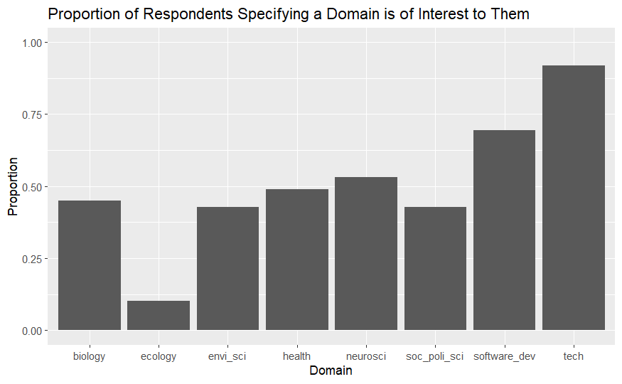
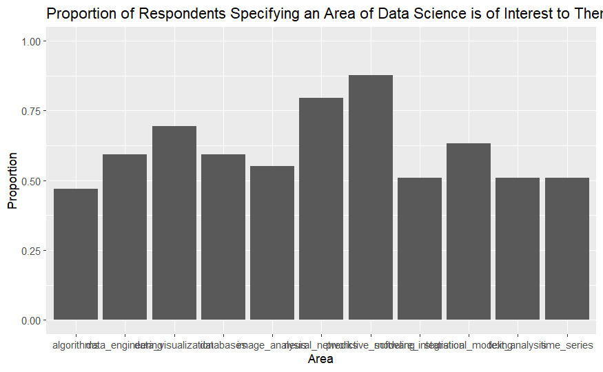
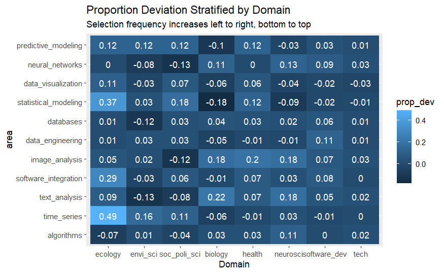
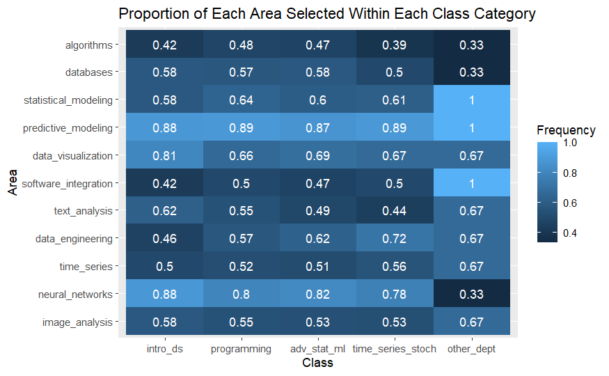
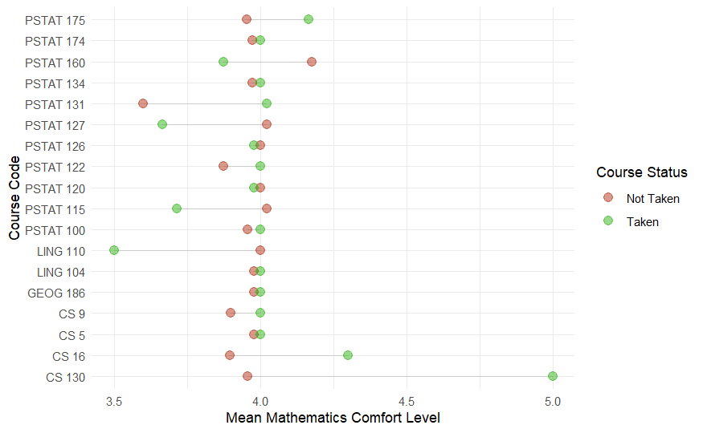
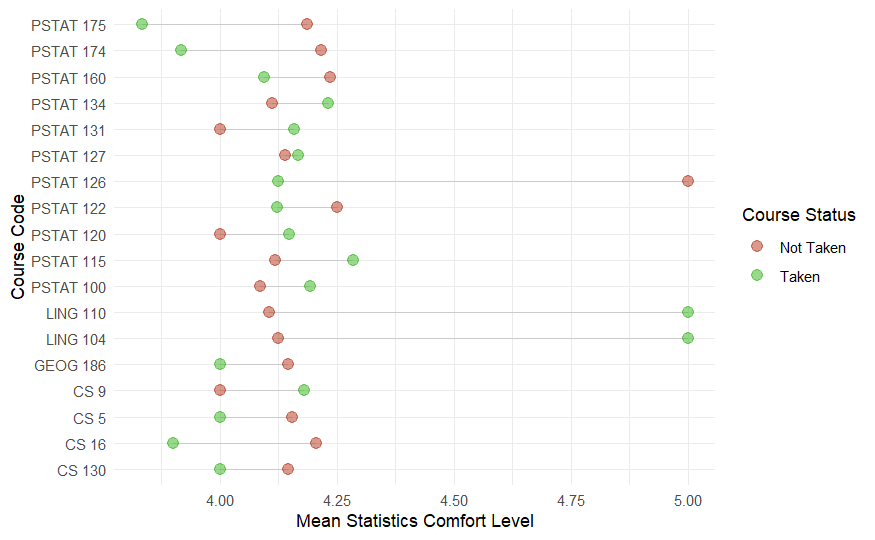
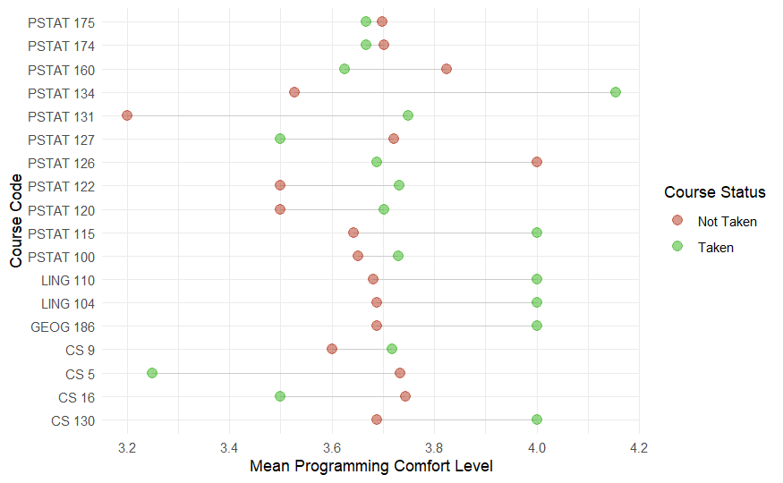
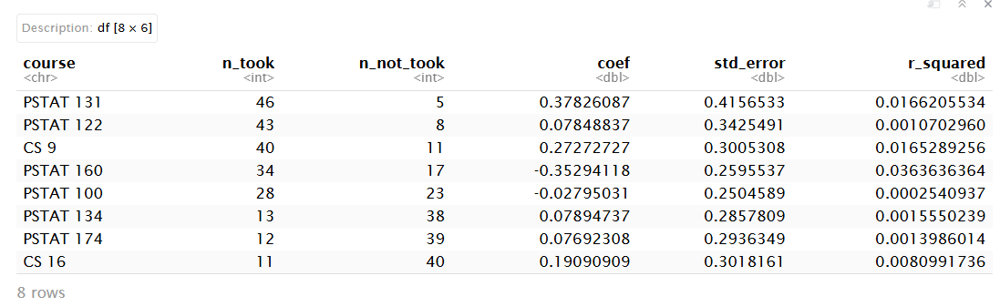
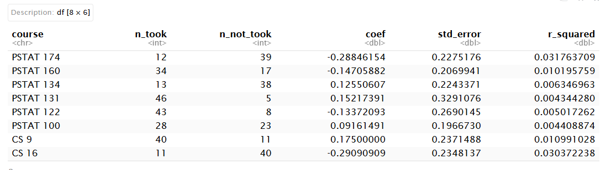
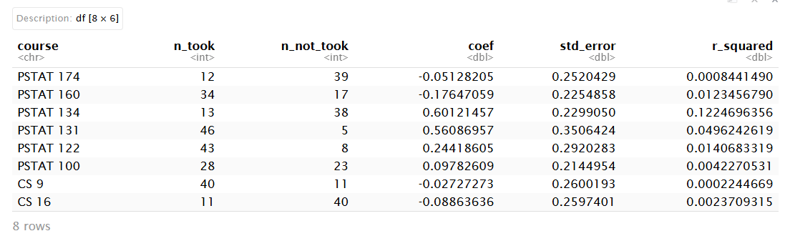

Use this as a template. Keep the headers and remove all other text. Overall, your report may be quite short. When it is complete, render and then push changes to your team repository.

```{r}
# load any other packages and read data here
library(tidyverse)
```

## Executive summary

In this module, we created heatmaps to visualize patterns in interest across areas of data science by domains of interest, and found many interesting results, such as, that those interested in neuroscience were more interested in image analysis compared to those not interested in neuroscience and similar for those interested in health/biology compared to those not interested in health/biology. Next, we created a heatmap to visualize patterns in interest across areas of data science by classes taken and conducted Fisher's exact test for each class/area pair. While interests were high across all data science areas, none of the differences between class-taken and non-taken groups remained statistically significant after Benjamini-Hochberg adjustment. Finally, we created a dot plot to see general comfort with math/statistics/programming across different classes taken and performed a linear regression for each class. We found that certain classes were more meaningful to analyze over others, but overall, courses had no clear association with comfort in math, statistics, nor programming.

## Data description

Our dataset was obtained as an intake form given to all students in the Data Science Capstone course for the 2026-2027 year.

Questions included demographic information such as major, class standing, gender identity, and race, and skills and experience information including self-perceived proficiency and comfort level with math, statistics, and programming, and major classes taken so far. The data for these questions can be found in "background_clean.csv".

Finally, project preferences questions included industry or research project preference, programming language preference, domain interests (environmental science, biology, technology, etc.), and area of data science interests (image analysis, time series, predictive modeling, databases, etc.). The data for these questions can be found in "interests_clean.csv".

## Questions of interest

> We sought to investigate the relationship between domains of interest, areas of data science preferences, courses, and self-assessed comfort level with technical skills among PSTAT197A students. Our analysis addressed three questions:
>
> 1.  Does domains of interest (biology, technology, AI, etc.) predict preferences for certain areas of data science?
> 2.  Does previous classwork people have taken have a relation to preferences for certain areas of data science?
> 3.  Does corresponding classwork increase comfort with math/statistics/programming?

## Findings

```{r Load in Packages and Data}
library(tidyverse)
library(knitr)
background  <- read_csv("../data/background-clean.csv")
interest <- read_csv("../data/interest-clean.csv")
```

### Question 1:

Does domains of interest (biology, technology, AI, etc.) predict preferences for certain areas of data science?

{width="425"}

Bar Graph of the Proportion of Respondents who had a preference for each of the domains.

{width="420"}

Bar Graph of the Proportion of Respondents who had a interest in each of the areas of data science.



-   Those who selected biology didn't select predictive or statistical modeling as much.

-   Those who chose social/political science and health did seem to select predictive and statistical modeling at a higher rate than average.

-   Those who chose biology, neuroscience and software development are slightly more interested in neural networks than average. It is possible that those fields are better-suited to utilize neural networks.

-   Those who chose biology and neuroscience also are interested in image analysis AND text analysis.

### Question 2:

Does previous classwork people have taken have a relation to preferences for certain areas of data science?

```{r}
add_class_groups <- function(data){
  data %>% mutate(prereq_core = str_count(courses, "PSTAT 120|PSTAT 122|PSTAT 126"),
                  intro_ds = str_count(courses, "PSTAT 100"),
                  programming = str_count(courses, "CS 5|CS 9|CS 16|CS 130"),
                  adv_stat_ml = str_count(courses, "PSTAT 115|PSTAT 127|PSTAT 131|PSTAT 134"),
                  time_series_stoch = str_count(courses, "PSTAT 160|PSTAT 174|PSTAT 175"),
                  other_dept = str_count(courses, "LING 104|LING 110|GEOG 186")
                  )
}
```

This code separates each of the major classes into different categories and counts how many classes taken in each category.

{width="546"}

This shows a heatmap of the proportion of the areas of data science within each of the categories of classes taken. We can see that interests are high across all areas of data science.

-   After Benjamini-Hochberg adjustment the smallest p-value is 0.17, showing that none of the differences between class-taken and non-taken groups remained statistically significant after the adjustment.

### Question 3:

Does corresponding classwork increase comfort with math/statistics/programming?

{width="523"}

Comfort in math comparing those who took a course and those who did not.{width="526"}

Comfort in statistics comparing those who took a course and those who did not.

{width="508"}

Comfort in programming comparing those who took a course and those who did not.



Linear regression on math comfort level across "PSTAT 131", "PSTAT 122", "CS 9", "PSTAT 160", "PSTAT 100", "PSTAT 134", "PSTAT 174", "CS 16". The estimated differences in mean comfort between class-takers and non-takers were very small and had standard errors and R\^2 that were insignificant. Overall, we can not say that taking any of these courses is related to higher or lower statistics comfort.



Linear regression on statistics comfort level across "PSTAT 131", "PSTAT 122", "CS 9", "PSTAT 160", "PSTAT 100", "PSTAT 134", "PSTAT 174", "CS 16". The estimated differences in mean comfort between class-takers and non-takers were very small and had standard errors and R\^2 that were insignificant. Overall, we can not say that taking any of these courses is related to higher or lower statistics comfort.



Linear regression on programming comfort level "PSTAT 131", "PSTAT 122", "CS 9", "PSTAT 160", "PSTAT 100", "PSTAT 134", "PSTAT 174", "CS 16". The estimated differences in mean comfort between class-takers and non-takers were very small and had standard errors and R\^2 that were insignificant. Overall, we can not say that taking any of these courses is related to higher or lower programming comfort.
